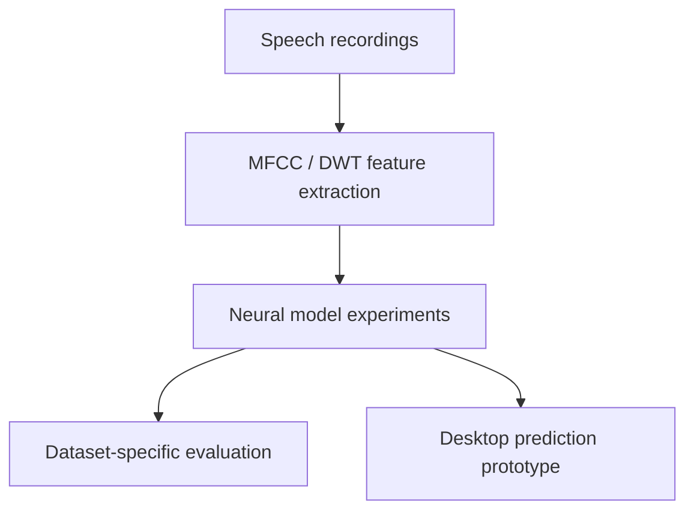

# Speech Emotion Recognition
**Audio processing · Deep learning · Model comparison · Desktop inference**

A research project exploring how speech features and neural architectures affect emotion classification. The work combines MFCC features, discrete wavelet decomposition and sequence models, with experiments across four speech datasets and a desktop prediction prototype.

[Project report](reports/CSH2.pdf) · [Research notebooks](notebooks/experiments/) · [Recorded results](results/metrics/) · [Demonstration guide](docs/DEMO.md)

## Work included

- MFCC feature extraction and wavelet decomposition experiments.
- LSTM, CNN-LSTM, ResNet-LSTM and RNN architecture variants.
- Dataset-specific validation accuracy, precision, recall and F1 records.
- A Tkinter interface and saved-model prediction implementation.

## Workflow

The maintained desktop entry point uses the uploaded MFCC-only LSTM checkpoint. It is separate from the DWT CNN-LSTM research experiments.

## Recorded CNN-LSTM results

| Dataset | Validation accuracy | MFCC count | DWT level | Epochs |
|---|---:|---:|---:|---:|
| TESS | **99.64%** | 40 | 1 | 500 |
| CREMA-D | 48.96% | 40 | 2 | 500 |
| SAVEE | 75.00% | 40 | 1 | 500 |
| RAVDESS | 59.03% | 40 | 1 | 500 |

Source: [uploaded validation CSV](results/metrics/Validation_Highest_Accuracy_Metrics_CNN_LSTM.csv). These are recorded validation results from separate experiments. The variation between datasets is a key finding: a high score on one dataset does not establish performance on another.

## Original experiment visuals

### CNN-LSTM

### LSTM

These are original uploaded experiment outputs.

## Repository guide

| Location | Contents |
|---|---|
| [notebooks/experiments/](notebooks/experiments/) | Training, features and architecture variants |
| [notebooks/analysis/](notebooks/analysis/) | Metric summaries and plotting notebooks |
| [results/](results/) | Recorded metrics and original figures |
| [reports/](reports/) | Uploaded project report |
| [app.py](app.py) / [predict.py](predict.py) | Maintained desktop and CLI inference |
| [archive/](archive/) | Earlier versions of replaced demo notebooks |
| [docs/](docs/) | Walkthrough, inventory and technical notes |

**Start with the report**, then follow the experiments and evaluation evidence.

Setup and future work

Install requirements.txt in a separate Python environment and run python app.py. The correct checkpoint label-order JSON is required. [Full demonstration instructions](docs/DEMO.md).

Future work: restore verified dataset/checkpoint metadata, confirm speaker-independent evaluation and rerun the selected configuration. Model inference has not been independently rerun in this workspace.

[Implementation notes](docs/REPAIRS.md) · [Initial review](docs/REPRODUCIBILITY.md)

